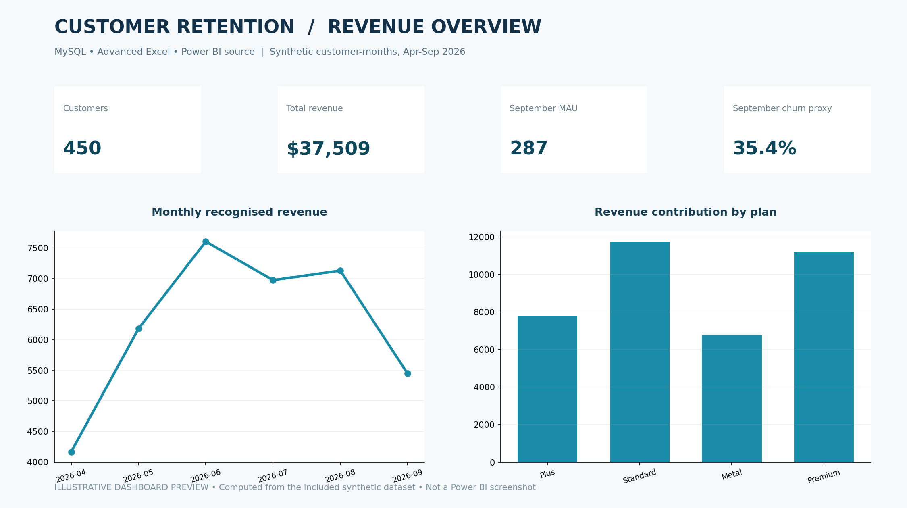

# FinTech Customer Churn & Revenue Analytics

**MySQL 8.0 · Advanced Excel · Power BI (PBIP/PBIR/TMDL + DAX)** · Synthetic digital-banking portfolio · No Python project code

## Executive brief

Investigate monthly active customer behavior, plan-level monetization, service friction and revenue changes for a simulated financial app. Calculate a **precisely defined month-over-month inactivity churn proxy**, prioritize high-value dormant customers and communicate the findings with SQL, Excel and Power BI.

**Business questions:** Are monthly customers engaging? Which membership plans generate recognized revenue? How many previously active users stopped transacting? Which accounts should operations contact first?

## Key outputs (computed from the included dataset)

| Metric | Example output |
| --- | ---: |
| Customers | 450 |
| Customer-month records | 2,458 |
| Total revenue proxy | $37,509.00 |
| September MAU | 287 |
| August active base | 379 |
| Became inactive in September | 134 |
| September inactivity-churn proxy | 35.36% |

## Contents

| Location | Contents |
| --- | --- |
| `data/` | Synthetic customers, six months of customer-month metrics, and support tickets |
| `sql/00_schema.sql` | MySQL schema, PK/FK constraints, and index |
| `sql/01b_seed_*.sql` | Executable INSERTs, no CSV wizard required |
| `sql/02_business_analysis.sql` | 8 SQL queries: cohorts, monthly ARPAU, churn proxy, revenue growth, plan rank, outreach prioritization |
| `sql/03_quality_checks.sql` | Data completeness and component revenue reconciliations |
| `excel/` | Formula-driven churn & revenue workbook, monthly dashboard and plan comparisons |
| `powerbi/` | PBIP report source, explicit DAX KPIs, TMDL tables, PBIR report pages |
| `assets/` | Illustrative dashboard preview (not a Power BI screenshot) |
| `docs/` | BRD, data dictionary, KPI methodology and business recommendations |

## How to reproduce

1. Run SQL scripts in the sequence documented in `sql/01_import_order.txt` on MySQL 8.0+.
2. Run `sql/03_quality_checks.sql`; expect 450 customers, 2458 customer-month rows and 184 support tickets with no integrity exceptions.
3. Run `sql/02_business_analysis.sql`; the September activity-churn query should return **35.36%**.
4. Open `excel/FinTech_Churn_Revenue_Analysis.xlsx` and inspect the formula-driven Executive_Dashboard plus the `IF`, `EDATE` and `INDEX/MATCH` transformations in Monthly_Data.
5. Optionally open `powerbi/Customer_Churn_Revenue_Intelligence.pbip` in Power BI Desktop and validate/resave if necessary, as explained in `powerbi/READ_ME_FIRST.md`.

## Data model / grain

- **Customers**: one row per customer (`customer_id`).
- **MonthlyMetrics**: one row per customer per eligible calendar month (composite SQL PK `customer_id`, `month_start`).
- **SupportTickets**: one row per created ticket (`ticket_id`), zero or more tickets/customer.
- Relationships: Customers 1:* MonthlyMetrics and Customers 1:* SupportTickets.

## Definition that matters most

> **September inactivity-churn proxy** = Customers active in August but not active in September / All customers active in August.

*Active means at least one transaction during that month.* New activations are excluded from the August denominator. Customer abandonment cannot be proven without account closure or cancellation data.

## Techniques demonstrated

SQL joins, CASE, CTEs, GROUP BY/HAVING, `LAG`, `DENSE_RANK`, monthly revenue growth and retention cohorts. Excel `SUMIFS`, `IF`, `AND`, `IFERROR`, `INDEX/MATCH`, `EDATE`. Power BI star model, slicer-ready KPIs, `CALCULATE`, `DIVIDE`, `REMOVEFILTERS`, `RANKX`, `SUMX`.

## Repository description for GitHub

> Synthetic digital-banking customer retention and revenue analytics with MySQL, Advanced Excel and Power BI. Includes churn definitions, KPI models, 6-month trends, SQL investigations and PBIP source assets.

**Suggested GitHub topics:** `fintech` `customer-retention` `churn-analysis` `revenue-analytics` `mysql` `power-bi` `excel` `dax` `business-analysis`

## Ethical portfolio disclosure

This is an independently prepared **synthetic analytics case study**. It does not contain real banking customer data and does not imply employment, partnership, or endorsement by Revolut or any other financial institution. Dashboard images are computed illustrative previews, not Power BI application screenshots.

## Reproducibility note

- SQL datasets and Excel workbooks are populated; aggregate results are checked against source records.
- PBIP report source is provided, **but Desktop runtime rendering was not tested here**. Please do not describe the image as a real Power BI screenshot.
- No Python notebooks or scripts are part of the repository.
